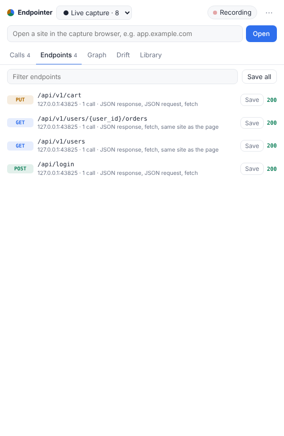
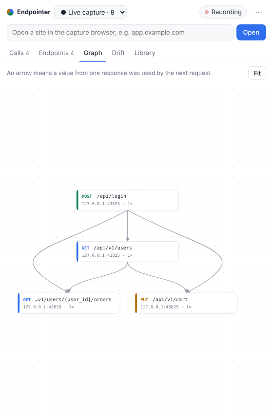
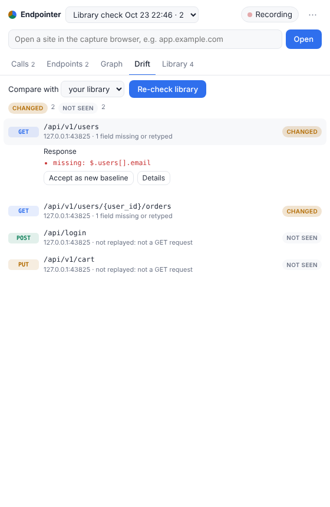

# Endpointer

A small desktop utility that sits next to your browser and records the API calls the sites you use make. It works out which calls matter, keeps the ones you save, draws how they depend on each other, and tells you when an API has drifted since you last looked.

It works with any website or web app. There's no proxy to set up and no certificate to install.

<p>



</p>

## What it does

- **Captures.** Endpointer opens a separate Chrome, Edge, Brave or Chromium window with its own profile. Your logins in that window are kept between runs. Every request any tab makes is recorded through the browser's DevTools protocol, with request and response bodies. You can also attach to a browser you started yourself, or import a HAR file from any browser, Firefox and Safari included.
- **Finds the calls that matter.** Static files, pre-flight requests, analytics, ads, error reporting and tracking beacons are hidden. JSON APIs, calls to the site you're on, calls that change data, GraphQL operations, and calls whose responses feed other calls rank higher. Each call shows why it was kept. You can hide a host or endpoint, or pin one so it's always shown.
- **Groups calls into endpoints.** Ids in paths become placeholders, so `GET /users/42` and `GET /users/97` are both `GET /users/{user_id}`. GraphQL calls are grouped by operation name. Each endpoint gets an inferred shape: its statuses, query parameters, request body schema and response schema.
- **Saves them to a library.** One click saves an endpoint along with its shape, which becomes the baseline. You can add a name, notes and tags. Saved endpoints are always shown.
- **Detects drift.** Compare any capture with your library, or with an earlier capture, to see what changed:

  | Level | Means |
  |---|---|
  | failing | It used to succeed and now only returns errors (404, 405, 400, 422, …) |
  | changed | A response field disappeared or changed type, or there's a new error status |
  | unsure | It only returned "not right now" answers, like logged out (401/403), rate limited or 5xx |
  | minor | New response fields, or the request is sent differently |
  | new / not seen | It's only in the later capture, or only in the baseline |

  **Re-check library** replays every saved GET request from the capture browser and compares the results with your library. Each replay runs in a tab on the original site and uses your current session. Only GETs are replayed, so nothing is ever created, changed or deleted. Fields that are only sometimes present, and lists that came back empty, don't count as drift. If the change is expected, **Accept as new baseline** updates the endpoint, and the old baseline is kept in its history.
- **Draws dependencies.** When a value from one response shows up in a later request, the two endpoints are linked. That value might be an id, a cursor or a token, and it might reappear in the path, the query, the body or an auth header. For example, `POST /login` → `GET /users` (via the access token) → `GET /users/{user_id}/orders` (via `users[].id`). Hover over a node to highlight its neighbours, and click it for details.

## Install and run

You need Python 3.10+ and Chrome, Edge, Brave or Chromium. There are no other dependencies.

```bash
pip install -e .
endpointer                      # opens the window; type a site and press Open
```

| Option | |
|---|---|
| `--launch URL` | Opens the capture browser on `URL` right away |
| `--attach 9222` | Uses a browser you started with `--remote-debugging-port=9222 --user-data-dir=<dir>` |
| `--browser PATH` | Picks which browser to use (or set `ENDPOINTER_BROWSER`) |
| `--home DIR` | Sets the workspace folder (default: `$ENDPOINTER_HOME` or `~/.endpointer`) |
| `--no-window` | Only prints the URL of the UI instead of opening a window |

From the command line:

```bash
endpointer import session.har --name "Checkout flow"
endpointer captures
endpointer drift <capture-id>                    # against your library; exit code 1 if anything failed or changed
endpointer drift <capture-id> --against <other-capture-id> --json
```

## Your data

```
~/.endpointer/
  captures/<id>.json      one browsing session's calls
  library/<name>.json     one saved endpoint: baseline shape, an example call, earlier baselines
  config.json             your hide/pin rules
  .salt                   key for secret fingerprints (git-ignored)
  browser-profile/        the capture browser's profile (git-ignored)
```

Everything is plain JSON, so the workspace can be a git repository. A `.gitignore` is created for you.

**Secrets are never written to disk.** This covers `Authorization`, cookies, API-key and token headers, and `password`/`token`/`secret` fields in bodies or queries. Each one is replaced with a `<secret:…>` fingerprint, keyed with a random per-workspace salt. That way you can still see that a request used the token from a particular login response, without the token itself being stored. Captures exported as HAR are redacted the same way.

The UI is served on `127.0.0.1` only. Its API needs a per-run token and rejects requests with a foreign `Host` header, so other websites can't read from it.

## How it's built

| Module | |
|---|---|
| `endpointer/cdp.py`, `websocket.py` | Launches the browser, attaches to every tab, frame and worker, and turns DevTools network events into calls |
| `model.py` | Calls, path templating, redaction |
| `classify.py` | Relevance scoring and noise lists |
| `deps.py` | Dependency inference |
| `shapes.py`, `drift.py` | Schema inference and comparison, endpoint shapes, drift levels |
| `store.py` | The workspace |
| `app.py`, `server.py`, `ui/` | Application state, the local JSON API, and the single-page UI (no build step, no CDN) |

Development: `pip install -e ".[dev]"`, then `pytest` and `ruff check .`. The end-to-end test drives a real headless Chromium against a small demo site (`tests/demo_site.py`). It's skipped when no browser is found, so set `ENDPOINTER_BROWSER` to run it.

## Verkada endpoint checker

This repository started as a Verkada-specific command-line checker adapted from vCommander. It's still here, unchanged, as `endpoint-checker` (see [endpoint_checker/README.md](endpoint_checker/README.md) and [catalog/](catalog/README.md)). Endpointer doesn't depend on it. The two share only the response-shape code (`endpointer/shapes.py`).
